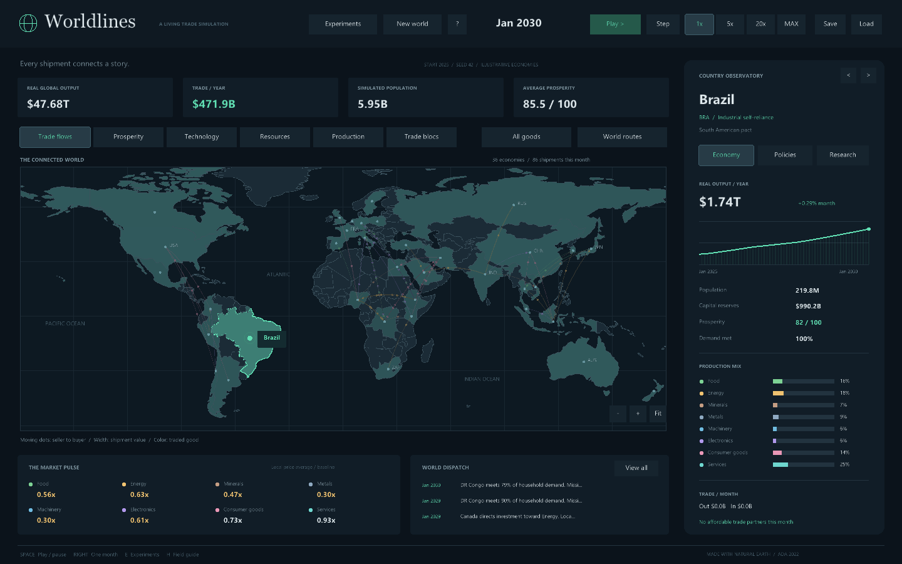

# Worldlines

Created in celebration of **Ada Lovelace Day**, honoring Ada Lovelace's legacy and the women whose curiosity, creativity, and contributions shape science, technology, engineering, and mathematics. Building this world in Ada is part of that celebration.

A native Ada 2022 economic ant farm. Watch 36 countries produce goods, compete for imports, develop productive knowledge, and invest according to their own priorities. Then change an incentive and follow the consequences.



## Play

Double-click **Start-Worldlines.cmd** in this folder. The built executable is in `bin/ada_experiments.exe`. The launcher runs the app from the project folder, where it stores snapshots and CSV exports.

To build or run with Alire:

```powershell
alr build
alr run
```

The existing Raylib dependency and local native library pin remain in place. On Windows the interface uses installed Segoe UI and Georgia fonts; other systems fall back to Raylib's built-in font. The app runs offline and opens paused in January 2025 with Brazil selected.

## Explore

- **World map:** real Natural Earth country polygons, clickable countries, zoom and pan. Background countries are geography only; 36 highlighted countries have economic models.
- **Six layers:** trade, prosperity, technology, resources, production and trade blocs.
- **Trade routes:** curved paths, value-based widths, goods colors and directional particles while running. Shows the 90 largest shipments matching the selected filter. Switch between world routes and the selected country's routes.
- **Country observatory:** real output history (up to ten years), population, capital, demand fulfillment, production mix, imports, exports and strongest trading partner. Arrow buttons reach every simulated country.
- **Policies:** change tariffs, industrial investment, research and infrastructure funding. Editing a slider holds that country's policy under player control; restore autonomy to return its funding to its national priorities.
- **Research:** inspect five technology fields and infrastructure. Knowledge improves production, input efficiency and logistics; manufacturing knowledge supports advanced industry.
- **Market pulse:** average local prices relative to their starting baseline. Click a good to filter routes; services are domestic and have no international shipments.
- **Dispatch:** events describe actual market or investment conditions. Open the full history and scroll through the latest 60 events. Click a national event to select its country.
- **Experiment lab:** industrialization, global tariffs, a two-year energy shock, African free trade, and a manufacturing breakthrough in the selected country.
- **Reproducible worlds:** choose a seed, save/load the entire world, or export its current country indicators as CSV.

| Control | Action |
|---|---|
| Space | Pause or resume |
| Right arrow | Advance one month |
| 1 / 2 / 3 / 4 | 1x / 5x / 20x / maximum speed |
| Tab | Next map layer |
| Mouse wheel over map | Zoom |
| Middle mouse drag | Pan |
| E / H / R | Experiments / field guide / new world |
| F5 / F9 | Save / load `worldlines.sav` |
| S | Export `worldlines-export.csv` |

The resizable interface scales a 1440x900 layout and supports windows down to 960x600. Dialogs suspend time. A normal month takes 0.65 seconds at 1x; maximum speed is 100x, bounded to 16 economic steps per rendered frame.

## The economy

Each monthly cycle:

1. Existing inventories decay, then agriculture and extraction produce food, energy and minerals.
2. Manufacturing consumes stocked inputs to make metals, machinery, electronics and consumer goods. Downstream output cannot exceed its available inputs. Services use national productive capacity and knowledge.
3. Countries reserve goods for household needs and the next industrial cycle. Local prices move gradually toward the ratio of desired reserves to actual supply, with bounded price limits.
4. Buyers compare delivered offers, including great-circle distance, infrastructure, logistics, landlocked costs, tariffs, blocs and poor relations. A purchase requires a surplus seller, an attractive offer and available buyer capital.
5. Every shipment transfers physical goods and seller revenue. Transport and tariff costs are accounted for as trade friction. Households consume what is available; unmet demand affects prosperity.
6. Retained domestic value added funds investment. Governments score sectors using prices, resource endowments, national priorities and a seeded variation that can produce imperfect decisions. Expansion consumes both capital and machinery. Productive capacity also depreciates.
7. Research, infrastructure and knowledge diffusion improve future production and trade. Population changes slowly with prosperity.

Four autonomous philosophies produce different allocation preferences: citizen prosperity, industrial self-reliance, open markets, and technology leadership. Player policy settings compete for a limited investment budget; funding is normalized if the combined allocations exceed 100%.

**These are illustrative economies, not historical measurements or forecasts.** Population scales loosely resemble the mid-2020s. Resource and technology profiles are hand-authored assumptions. Output is annualized monthly value added at fixed baseline prices, expressed in a fictional common accounting currency. It is distinct from spendable capital and is not a scripted GDP growth rate.

This version deliberately simplifies labor into population-scaled capacity, treats services as domestic, keeps bloc membership fixed, and abstracts tariffs into trade friction rather than government revenue. It does not model exchange rates, debt, companies, elections or military systems. Inventories are bounded, excess output can be discarded, and investment is intentionally gradual. The model is an experimental hobby simulation rather than a calibrated macroeconomic model.

## Verify

```powershell
alr exec -- .\bin\ada_experiments.exe --self-test
alr exec -- .\bin\ada_experiments.exe --smoke-test
alr exec -- .\bin\ada_experiments.exe --headless 300 --seed 42
alr exec -- .\bin\ada_experiments.exe --capture preview.png --smoke-test
```

The headless suite checks 600 deterministic monthly cycles, valid stocks/prices/cash, seed variation, trade accounting, physical energy shocks and price responses, geography-dependent transport, tariff divergence, full snapshot restoration, continued replay, corrupt-file rejection and CSV output. The graphical smoke test runs for about two seconds, exercises the actual button/slider handlers and all map layers/dialogs, checks polygon selection, and closes automatically. With `--capture`, it also saves the main view and diagnostic screenshots for policies, research, experiments, help, new world and dispatch.

Other options: `--seed N`, `--assets DIR`, `--help`. Snapshots use versioned Ada stream serialization and should be re-created when the saved-state record or compiler representation changes. Invalid/truncated snapshots leave the current world intact.

## Source layout

| Source | Purpose |
|---|---|
| `src/economy.ads`, `src/economy.adb` | Graphics-independent economic model, experiments, persistence and export |
| `src/starting_world.adb` | The 36 illustrative country profiles |
| `src/world_geography.*` | Offline geometry loader and triangle hit testing |
| `src/worldlines_ui.*` | Native Raylib interface, map cache and controls |
| `src/simulation_tests.*` | Deterministic economic verification |
| `src/ada_experiments.adb` | Desktop and command-line entry point |
| `tools/prepare-map.cjs` | Optional build-time dataset converter; Node is not needed to play or compile |
| `share/world.map` | Pre-triangulated country polygons and border segments |

The converter reads `share/countries.geojson` and regenerates both the map and country profiles. Edit its profile table when changing initial assumptions. Rendering uses the polygon exterior rings at Natural Earth's 1:110m scale, omits Antarctica and clips the world to a readable latitude range; very small states may not have visible polygons at this scale.

## Map provenance

Made with [Natural Earth](https://www.naturalearthdata.com/). Its boundaries are [public domain](https://www.naturalearthdata.com/about/terms-of-use/). The source file is [`ne_110m_admin_0_countries.geojson`](https://github.com/nvkelso/natural-earth-vector/blob/master/geojson/ne_110m_admin_0_countries.geojson). Country bounds and screen locations come from this geographic dataset; economic profiles are separate illustrative inputs.

The original development setup notes are preserved in `docs/DEVELOPMENT.md`. The project retains its existing declared license, `MIT OR Apache-2.0 WITH LLVM-exception`; Raylib has its own license in the vendor folder.
